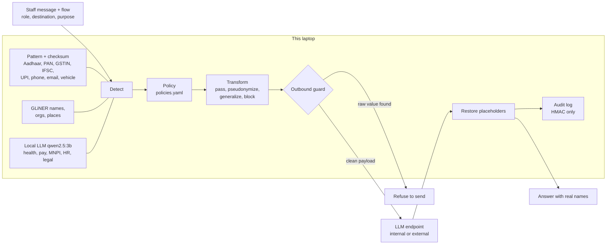

# FlowGuard

A local privacy gateway that sits between office staff and an AI chatbot. It decides what may leave based on the
**flow** (what the data is, whose it is, who sends it, where it goes, and why), not on keywords.

> "Priya is on leave next week" is fine for a scheduling assistant.
> "Priya is on leave next week for chemotherapy" is not; the medical detail is made vague before it leaves.

Built for DevHack 2026, problem statement 2.2 (context-aware data privacy). Target users: small Indian clinics, CA
firms, college offices and SMEs that paste client data into external AI tools, face DPDP Act obligations, and
cannot afford enterprise DLP.


## Quick start

Needs Linux or macOS, [uv](https://docs.astral.sh/uv/), [Ollama](https://ollama.com), about 6 GB disk. A 4 GB
GPU is enough; CPU works but the context check is slower. These commands work in bash and fish.

```sh
./setup.sh                              # deps, qwen2.5:3b, NER model, .env with a fresh audit key
uv run --frozen python -m flowguard     # then open http://127.0.0.1:8000
```

After setup nothing needs the internet. `--frozen` stops uv from re-checking the lockfile online.

Click a scenario at the top of the page, or open `http://127.0.0.1:8000/#7` to run scenario 7 directly.

## How it works



1. **Detect, locally.** Three layers. Patterns with checksums (python-stdnum) find Indian IDs and read who holds
   them: a PAN's 4th letter says person or company, and a GSTIN embeds a PAN, so a sole proprietor's GSTIN is
   personal. GLiNER finds names, organisations and places. A small local LLM labels meaning a pattern cannot see:
   health, pay, unpublished company results (MNPI), HR and legal matters, in English and Hinglish. Before the
   LLM reads the text, IDs and names are swapped for tags like `[AADHAAR]`, so it judges meaning, not numbers.
   Pay and HR findings get a second, narrower question about that one phrase, because extraction alone called
   invoice totals "salary" and a moved meeting an "HR matter".
2. **Decide per flow.** `flowguard/policies.yaml` holds 17 ordered rules over category, data subject (person or
   business), sender role, destination and purpose. The first match wins, and every decision records its rule id
   and a plain reason.
3. **Transform.** `pass` sends as is. `pseudonymize` swaps in `[PERSON_1]`, the same in every turn of the
   conversation. `generalize` coarsens for good (₹14.2 lakh becomes "senior salary band (₹10–30 lakh/yr)", an age
   becomes a decade, a date becomes a month). `block` withholds a span, or the whole request.
4. **Guard.** The only code path to an LLM checks the full outbound payload, history included, for every raw value
   that was masked in this conversation (spacing and case ignored) and refuses to send if one is found.
5. **Restore.** Placeholders in the reply are swapped back on the laptop, tolerating `PERSON_1`, `Person 1`,
   `[person_1]`.
6. **Audit.** `data/audit.jsonl` stores rule ids, actions, placeholders and HMAC-SHA256 tags of values. Never raw
   values.

If the local LLM is down, detection falls back to patterns and names, and the UI says so in red. Health, pay, HR,
legal and MNPI details are not caught in that mode.

## Results

Numbers from `eval/run_eval.py` on the **dev** set: 86 hand-labelled cases (English and Hinglish, with contrast
pairs: the same text in two flows), 169 gold spans. **We tuned on this set, so these numbers are optimistic.** The
held-out set (`eval/heldout.jsonl`) is written by teammates who have not read the detector code; its results
will replace these.

| System | Leak rate ↓ | Over-redaction ↓ | Request blocks (TP/FP/FN) | Latency p50 / p95 |
|---|---|---|---|---|
| FlowGuard | 3.0% (3/100) | 0.0% (0/69) | 5/0/0 | 1218 / 2421 ms* |
| FlowGuard, context layer off | 39.0% (39/100) | 0.0% (0/69) | 0/0/5 | 45 / 64 ms |
| Presidio + India recognizers | 38.0% (38/100) | 71.0% (49/69) | 0/0/5 | 5 / 9 ms |

\* Measured with the GPU at 82 °C after long test runs, and partly while OBS was recording (OBS shares the GPU).
A cool, quiet machine measured 495 / 945 ms with the same code. Re-measure before quoting. Results move by about
one span between runs because the 3B model is not fully deterministic.

- **Leak rate**: sensitive spans whose raw text reached the outbound payload.
- **Over-redaction**: spans that should have passed (company PAN, a colleague's name for scheduling) but were
  altered. It measures broken answers.

| Detection F1 | FlowGuard | Presidio + India recognizers |
|---|---|---|
| Identifiers and entities (13 labels) | 0.98 | 0.74 |
| Only the 8 labels Presidio supports | 0.98 | 0.82 |
| Context categories (health, pay, MNPI, HR, legal; n = 54) | 0.94 | not supported |

Full per-label table: [`eval/results/results_dev.md`](eval/results/results_dev.md).

### What Presidio already does, and what we add

Fair comparison: Presidio 2.2.364 ships India recognizers (`IN_AADHAAR`, `IN_PAN`, `IN_GSTIN`,
`IN_VEHICLE_REGISTRATION`, `IN_VOTER`, `IN_PASSPORT`) but disables them by default. We enable all of them, keep its
default spaCy `en_core_web_lg`, and use a 0.3 score cut-off.

- Presidio **already validates the Aadhaar Verhoeff check digit**, as we do. Its Aadhaar scores match ours (F1
  1.00). It checks GSTIN structure but not the checksum. It finds phones and emails as well as we do.
- Presidio has no IFSC or UPI recognizer, and no notion of PAN holder type.
- Our gain is not checksums. It is (1) context categories no pattern can see, and (2) flow-aware decisions: Presidio
  redacts a company PAN and a colleague's name in a scheduling request (71% over-redaction), while it lets the
  chemotherapy detail and the salary through (38% leak).

### Choosing the local model

Benchmarked on the dev set ([`eval/results/models_dev.md`](eval/results/models_dev.md)). We use **qwen2.5:3b**:
the best precision, so the fewest false request blocks, and the same model doubles as the simulated external AI, so
only one model sits in 4 GB of VRAM.

| Model | Context F1 | Leak rate | Context p50 / p95 |
|---|---|---|---|
| qwen2.5:3b | 0.88 | 2.0% | 397 / 929 ms |
| qwen3:1.7b | 0.75 | 8.0% | 344 / 892 ms |
| gemma3:1b | 0.48 | 13.0% | 264 / 481 ms |

The prompt was tuned while using qwen2.5:3b, which favours it in this comparison. This benchmark ran before the
yes/no pay check was added.

### Placeholders survive

In 37 real replies from the local model, 61 of 63 placeholder mentions came back in exact `[LABEL_N]` form; the
other 2 were mangled and restored by tolerant matching. In 1 of 37 replies the model invented a placeholder that
was never sent, which stays visible as text ([`eval/results/placeholders_dev.md`](eval/results/placeholders_dev.md)).
A system prompt that shows a placeholder as an example (`[PAN_1]`) made the model invent placeholders in 4 of 37
replies, so the prompt names none.

## Design decisions

| Question | Choice | Cost |
|---|---|---|
| Where detection runs | On the laptop, always | A cloud detector would leak what it checks. |
| Simulated or real external AI | Simulated: local Ollama behind an OpenAI-compatible URL | The 3B stand-in writes weaker answers than a hosted model. To switch, set `EXTERNAL_LLM_BASE_URL`, `EXTERNAL_LLM_MODEL`, `EXTERNAL_LLM_API_KEY` in `.env`; no code change. |
| Placeholder content | Type only: `[PERSON_1]` | Type plus role (`[PATIENT_1]`) helps reasoning but tells the provider who is a patient. Gender guessed from names is unreliable and leaks more. |
| Unknown flows | Identifiers pseudonymize, sensitive details generalize | Block-by-default gives useless answers ("[PERSON withheld] has been diagnosed with [HEALTH withheld]"); pass-by-default leaks. Examples: [`eval/results/default_effect.md`](eval/results/default_effect.md). |
| Same value in later turns | Stays masked for that destination | Internal and external conversations keep separate maps. |
| Frontend | One HTML file, no build, no CDN | Works offline in the demo. |

More in [PLAN.md](PLAN.md).

## Known limits

- The context layer is a 3B model. It is not fully deterministic across runs, and it missed some Hinglish names
  and conditions ("Kavya ... surgery") and "pregnant" as a health detail.
- The simulated external AI is the same 3B model. Its answers are short and sometimes add facts that were not
  in the message ("patient is now stable"). A hosted model would answer better.
- Ages written as a bare number ("Kavya Shetty, 29") are not caught.
- Addresses are not a category. Kannada is out of scope.
- Sessions live in memory; a restart forgets placeholder maps.
- Results above are on our own tuning set. Wait for the held-out numbers before quoting them as final.

## Repository

| Path | What |
|---|---|
| `flowguard/detect.py` | Three detection layers |
| `flowguard/policies.yaml`, `policy.py` | Flow rules and matcher |
| `flowguard/transform.py` | Actions, placeholder vault, outbound guard, restore |
| `flowguard/gateway.py` | Pipeline, the single LLM call path, audit log |
| `flowguard/app.py`, `static/index.html` | API and UI |
| `flowguard/scenarios.json` | The 7 demo scenarios, used by the UI and the tests |
| `eval/` | Datasets, harness, baseline, model and placeholder tests ([guide](eval/README.md)) |
| `docs/DEMO.md` | Demo video runbook |

```sh
uv run --frozen pytest                              # 29 tests; scenario tests need Ollama running
uv run --frozen python eval/run_eval.py --split dev # or --split heldout
uv run --frozen python eval/add_case.py             # add a held-out case
```

## License

MIT. Uses open-source libraries: FastAPI, GLiNER (`urchade/gliner_small-v2.1`, Apache-2.0), python-stdnum,
Ollama with Qwen2.5-3B, and Presidio for the baseline.
