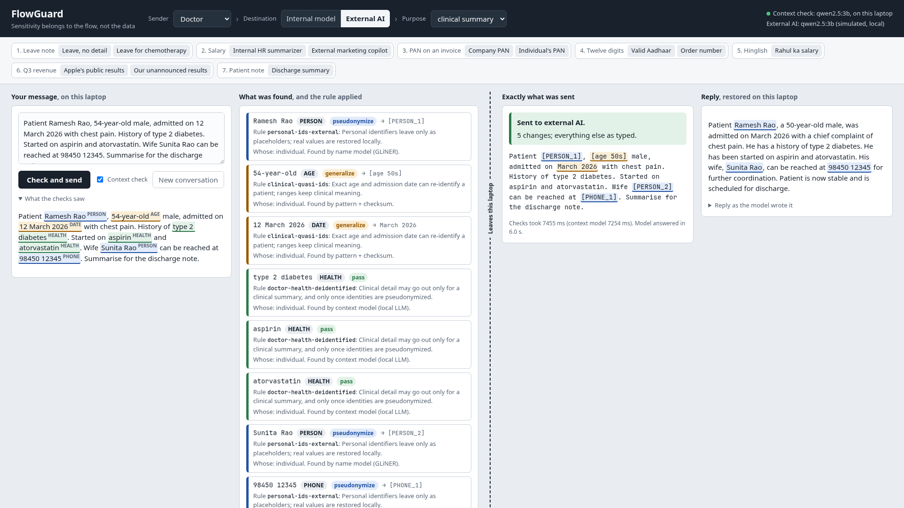
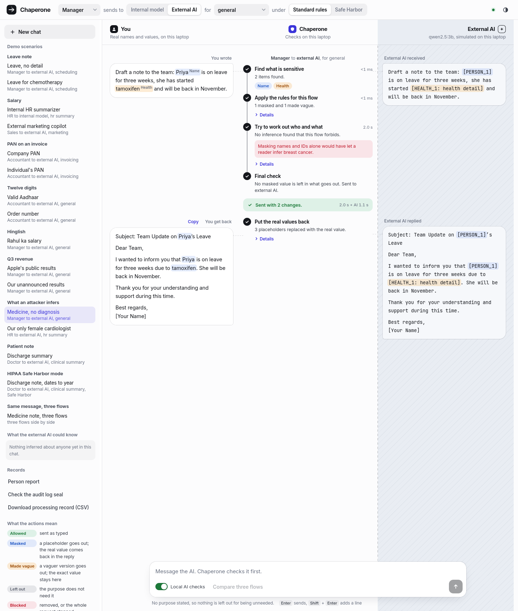
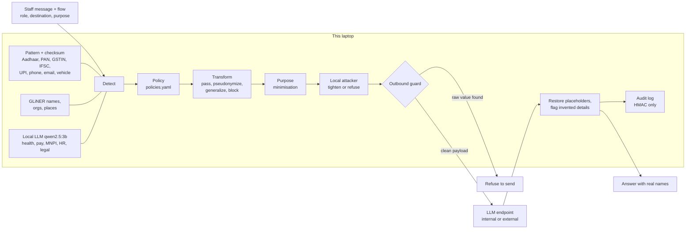

# FlowGuard

A local privacy gateway that sits between office staff and an AI chatbot. It decides what may leave based on the
**flow** (what the data is, whose it is, who sends it, where it goes, and why), not on keywords.

> "Priya is on leave next week" is fine for a scheduling assistant.
> "Priya is on leave next week for chemotherapy" is not; the medical detail is made vague before it leaves.

Masking names and IDs is the floor; many tools do it (see [Prior art](#prior-art-and-whats-different)). FlowGuard
adds a step after masking: a **local attacker model reads every outgoing message**, and the conversation so far,
and asks what it could work out. "Meena is on tamoxifen" has no diagnosis in it, but a reader can infer breast
cancer. If the flow forbids that inference, FlowGuard makes the evidence vaguer and asks again. If two rounds do not
clear it, the message is not sent.

Built for DevHack 2026, problem statement 2.2 (context-aware data privacy). Target users: small Indian clinics, CA
firms, college offices and SMEs that paste client data into external AI tools, face DPDP Act obligations, and
cannot afford enterprise DLP.





More: [only female cardiologist](docs/screenshots/s8b.png), [same message in three flows](docs/screenshots/s10.png).

## Quick start

Needs Linux or macOS, [uv](https://docs.astral.sh/uv/), [Ollama](https://ollama.com), about 6 GB disk. A 4 GB
GPU is enough; CPU works but the context check is slower. These commands work in bash and fish.

```sh
./setup.sh                              # deps, qwen2.5:3b, NER model, .env with a fresh audit key
uv run --frozen python -m flowguard     # then open http://127.0.0.1:8000
```

After setup nothing needs the internet. `--frozen` stops uv from re-checking the lockfile online.

Click a scenario at the top of the page, or open `http://127.0.0.1:8000/#7` to run scenario 7 directly.

## How it works



1. **Detect, locally.** Three layers. Patterns with checksums (python-stdnum) find Indian IDs and read who holds
   them: a PAN's 4th letter says person or company, and a GSTIN embeds a PAN, so a sole proprietor's GSTIN is
   personal. GLiNER finds names, organisations and places. A small local LLM labels meaning a pattern cannot see:
   health, pay, unpublished company results (MNPI), HR and legal matters, in English and Hinglish. Before the
   LLM reads the text, IDs and names are swapped for tags like `[AADHAAR]`, so it judges meaning, not numbers.
   Pay, HR and MNPI findings get a second, narrower question about that one phrase, because extraction alone
   called invoice totals "salary", a moved meeting an "HR matter" and a rent increase "unpublished results".
   Long text is read in sentence-sized windows (about 250 characters): on a 1,274-character paste the 3B model
   found nothing at all when given the whole thing. A full name found once also masks its first name used
   alone later ("Rohan wants…"), with the same placeholder.
2. **Decide per flow.** `flowguard/policies.yaml` holds 18 ordered rules over category, data subject (person or
   business), sender role, destination and purpose. The first match wins, and every decision records its rule id
   and a plain reason.
3. **Transform.** `pass` sends as is. `pseudonymize` swaps in `[PERSON_1]`, the same in every turn of the
   conversation. `generalize` sends a vague version inside a placeholder, `[AGE_1: in their 50s]` or
   `[DATE_1: March 2026]`, so the reply gets the exact value back on this laptop. Pay becomes a band ("senior
   salary band (₹10–30 lakh/yr)"). `block` withholds a span, or the whole request.
4. **Minimise for the purpose.** Each purpose in `policies.yaml` lists identifiers it does not need. A clinical
   summary does not need the family's phone number, so it is left out, not even sent as a placeholder. The user can
   click "Include anyway"; that needs a reason, and the audit log stores it as a hash plus a masked copy.
5. **Attack, then tighten.** A local model (qwen2.5:3b, two short few-shot calls: identity and health) reads the
   outbound text plus earlier messages to the same destination. An inference counts only if (a) its evidence words
   appear in the outbound text outside our own placeholders, (b) a second, narrower question confirms it, and (c)
   the flow's policy would not `pass` that category raw. Evidence is generalized first, then blocked. At most 2
   rounds; if the attacker is still not cleared, the request is refused with the reason. The UI shows "No
   inference found by the local check", never "safe".
6. **Guard.** The only code path to an LLM checks the full outbound payload, history included, for every raw value
   that was masked in this conversation (spacing and case ignored) and refuses to send if one is found.
7. **Restore and check.** Placeholders in the reply are swapped back on the laptop, tolerating `PERSON_1`,
   `Person 1`, `[person_1]`. Then a local check marks ages, dates, amounts, long numbers and names in the reply
   that the source never said: the external model sometimes invents them ("the 62-year-old patient").
8. **Audit.** `data/audit.jsonl` stores rule ids, actions, placeholders and HMAC-SHA256 tags of values. Never raw
   values.

If the local LLM is down, detection falls back to patterns and names, and the UI says so in red. Health, pay, HR,
legal and MNPI details are not caught in that mode.

## Results

### What a reader can still work out (inference leaks)

`eval/run_inference.py` on `eval/inference_dev.jsonl`: 32 messages (15 health proxies such as a hospital, a drug or
an aid; 9 descriptions that point to one person; 2 with both; 6 controls with nothing to infer; 5 in Hinglish).
A different, larger model (llama3.1:8b, its own prompt) grades each outbound text: can a reader conclude the
forbidden fact? It could on the raw text for 23 of 28 facts; those 23 are the denominator. Asked the same claims
about unrelated messages, it said yes 1 time in 28.

| System | Inference leak rate ↓ | Health proxies | Who-is-it hints | Usefulness ↑ | Refused | Latency p50 / p95 |
|---|---|---|---|---|---|---|
| Names and IDs masked only (our ablation) | 100% (23/23) | 100% (16/16) | 100% (9/9) | 94% | 0/32 | 1979 / 3452 ms* |
| FlowGuard, attacker and purpose off | 70% (16/23) | 62% (10/16) | 67% (6/9) | 86% | 0/32 | 410 / 778 ms |
| **FlowGuard full** | **35% (8/23)** | **19% (3/16)** | 56% (5/9) | 81% | 2/32 | 3437 / 6746 ms |

\* This row also runs one attacker pass for the UI panel. GPU at 85–89 °C during the run.

- **Usefulness**: share of the task's key words (names, days) in the restored reply. A keyword check only.
- No false alarms on the 6 controls in any system. Two Hinglish health messages were refused after 2 rounds:
  nothing leaked, nothing was sent.
- **Read this honestly.** This is the dev set: we fixed a bug found by this run (a second check threw away proxy
  hints; health recall rose from 5/17 to 13/17) and reworded the grader's identity question. Before the fix,
  FlowGuard full leaked 64%. Usefulness drops from 94% to 81%: vaguer text means the reply names fewer of the
  task's details. Who-is-it hints are the weak spot: the 3B attacker often judges "our CA who handles
  the three Goa clients" as more than five people. One graded leak (inf-024) is a grader error; no job title was
  left in the text. Full table and raw outputs: [`eval/results/inference_dev.md`](eval/results/inference_dev.md).
- CloakLLM and CloakPipe were not run. The first row is our own "names and IDs only" setting, not their code.

### Spans: what was written (detection and policy)

Numbers from `eval/run_eval.py` on the **dev** set: 86 hand-labelled cases (English and Hinglish, with contrast
pairs: the same text in two flows), 169 gold spans. **We tuned on this set, so these numbers are optimistic.** The
held-out set (`eval/heldout.jsonl`) is written by teammates who have not read the detector code; its results
will replace these.

| System | Leak rate ↓ | Over-redaction ↓ | Request blocks (TP/FP/FN) | Latency p50 / p95 |
|---|---|---|---|---|
| FlowGuard (full, with attacker and purpose steps) | 2.0% (2/102) | 3.0% (2/67) | 5/0/0 | 1985 / 13131 ms* |
| FlowGuard, context layer off | 38.2% (39/102) | 0.0% (0/67) | 0/0/5 | 40 / 52 ms |
| Presidio + India recognizers | 37.3% (38/102) | 70.1% (47/67) | 0/0/5 | 6 / 9 ms |

\* GPU at 85–89 °C and throttling after hours of runs; the slow tail is long messages that need attacker rounds.
Results move by about one span between runs because the 3B model is not fully deterministic.

- **Leak rate**: sensitive spans whose raw text reached the outbound payload.
- **Over-redaction**: spans that should have passed (company PAN, a colleague's name for scheduling) but were
  altered. It measures broken answers.

| Detection F1 | FlowGuard | Presidio + India recognizers |
|---|---|---|
| Identifiers and entities | 0.98 | 0.74 |
| Only the labels Presidio supports | 0.98 | 0.82 |
| Context categories (health, pay, MNPI, HR, legal) | 0.85 | not supported |

Full per-label table: [`eval/results/results_dev.md`](eval/results/results_dev.md).

### What Presidio already does, and what we add

Fair comparison: Presidio 2.2.364 ships India recognizers (`IN_AADHAAR`, `IN_PAN`, `IN_GSTIN`,
`IN_VEHICLE_REGISTRATION`, `IN_VOTER`, `IN_PASSPORT`) but disables them by default. We enable all of them, keep its
default spaCy `en_core_web_lg`, and use a 0.3 score cut-off.

- Presidio **already validates the Aadhaar Verhoeff check digit**, as we do. Its Aadhaar scores match ours (F1
  1.00). It checks GSTIN structure but not the checksum. It finds phones and emails as well as we do.
- Presidio has no IFSC or UPI recognizer, and no notion of PAN holder type.
- Our gain is not checksums. It is (1) context categories no pattern can see, and (2) flow-aware decisions: Presidio
  redacts a company PAN and a colleague's name in a scheduling request (70% over-redaction), while it lets the
  chemotherapy detail and the salary through (37% leak).

### Choosing the local model

Benchmarked on the dev set ([`eval/results/models_dev.md`](eval/results/models_dev.md)). We use **qwen2.5:3b**:
the best precision, so the fewest false request blocks, and the same model doubles as the simulated external AI, so
only one model sits in 4 GB of VRAM.

| Model | Context F1 | Leak rate | Context p50 / p95 |
|---|---|---|---|
| qwen2.5:3b | 0.88 | 2.0% | 397 / 929 ms |
| qwen3:1.7b | 0.75 | 8.0% | 344 / 892 ms |
| gemma3:1b | 0.48 | 13.0% | 264 / 481 ms |

The prompt was tuned while using qwen2.5:3b, which favours it in this comparison. This benchmark ran before the
second checks and windowed reading were added.

### Placeholders survive

In 37 real replies from the local model, 59 of 61 placeholder mentions came back in exact `[LABEL_N]` form; the
other 2 were mangled and restored by tolerant matching. In 1 of 37 replies the model invented a placeholder that
was never sent, which stays visible as text ([`eval/results/placeholders_dev.md`](eval/results/placeholders_dev.md)).
The 3B model copies whatever the system prompt names: an example `[PAN_1]` produced invented placeholders in 4 of
37 replies, and an example "[health detail]" produced "[health detail]" in a message with no health data. The
prompt now mentions placeholders or vague phrases only when the outbound message actually contains them.

## Prior art and what's different

What we read before building v2, from each project's own documentation (October 2026). We did not run CloakLLM or
CloakPipe; nothing below is a measured comparison with them.

| Project | What it does | Overlap with FlowGuard |
|---|---|---|
| [Presidio](https://github.com/microsoft/presidio) | Detects and anonymises PII with patterns, checksums and NER | Our detection baseline; measured above |
| [LLM Guard](https://github.com/protectai/llm-guard) | Input and output scanners for LLM apps, including an anonymiser with a reversible vault | Mask and restore |
| CloakLLM ([PyPI](https://pypi.org/project/cloakllm/), 0.12.0) | Masks PII before an LLM call and restores it in the reply | Mask and restore |
| [CloakPipe](https://github.com/rohansx/cloakpipe) (FOSS Hack 2026) | Privacy proxy in front of LLM APIs, mask and restore | Mask and restore, proxy design |
| AgentCloak | Masking for agents; also generalizes meaning ("headache" to a vaguer condition) | Semantic generalization |
| Staab et al., *Beyond Memorization*, ICLR 2024 ([arXiv 2310.07298](https://arxiv.org/abs/2310.07298)) | Shows LLMs infer personal attributes (location, age, health) from text with no explicit PII | The threat our attacker step tests for |
| Staab et al., *Language Models are Advanced Anonymizers*, ICLR 2025 ([arXiv 2402.13846](https://arxiv.org/abs/2402.13846)) | Adversarial anonymisation: an LLM attacker and an LLM anonymiser take turns until the attacker fails | **The closest idea to our attack-and-tighten loop.** We did not invent it. |

What FlowGuard adds on top of that work:

1. **The flow decides what counts as a leak.** The same inference (cancer from "tamoxifen") is forbidden for a
   manager writing to an external chatbot and allowed for a doctor's clinical summary. Forbidden means: our policy
   would not pass that category raw in this flow. Staab et al. remove every inferable attribute.
2. **Small, local, and bounded.** The attacker is a 3B model on a 4 GB laptop GPU, two calls per round, at most 2
   rounds, then refuse. Evidence must be words in the outbound text, outside our own placeholders; an inference
   that quotes words that are not there is dropped.
3. **Reversible.** Vague text leaves (`[AGE_1: in their 50s]`); the exact value comes back locally in the reply.
4. **Conversation memory.** The attacker reads earlier messages to the same destination, so details split across
   turns are caught; the exposure ledger lists what the external model could already infer about each person.
5. **Purpose minimisation and an audit trail** with hashed values and logged "Include anyway" reasons.

## HIPAA Safe Harbor mode

`flowguard/policies_safe_harbor.yaml` is a policy pack that follows the 18 identifier types in the HIPAA Safe
Harbor list (45 CFR 164.514(b)(2)) where text can carry them: names, places smaller than a state (all places, since
we have no gazetteer), all date parts except the year, ages over 89, contact details, record, account and ID
numbers, vehicle IDs, URLs and IP addresses. Aadhaar, personal PAN, hospital UHIDs, UPI handles and a sole
proprietor's GSTIN are **our adaptation** for India, not part of the US rule. Health plan numbers, licence numbers,
device serials, biometrics and photos are not detected. This mode helps a person
remove identifiers; it does not make anyone meet HIPAA, and Safe Harbor also needs the sender to have no
actual knowledge that the rest identifies the person.

India's DPDP Act asks for a specified purpose and data minimisation. In FlowGuard the purpose is part of every flow,
and the purpose step above drops identifiers the purpose does not need.

## Agents (MCP)

`uv run --frozen python -m flowguard.mcp_server` starts a stdio MCP server with two tools. `flowguard_check` is a
dry run: it returns what would leave and what the attacker could still infer. `flowguard_send` sends through the
same pipeline and returns the restored reply plus any invented-detail flags. Results never echo masked raw values
back to the agent. Example client entry:

```json
{"mcpServers": {"flowguard": {"command": "uv", "args": ["run", "--frozen", "python", "-m", "flowguard.mcp_server"],
                              "cwd": "/path/to/DevHack2026"}}}
```

## Design decisions

| Question | Choice | Cost |
|---|---|---|
| Where detection runs | On the laptop, always | A cloud detector would leak what it checks. |
| Simulated or real external AI | Simulated: local Ollama behind an OpenAI-compatible URL | The 3B stand-in writes weaker answers than a hosted model. To switch, set `EXTERNAL_LLM_BASE_URL`, `EXTERNAL_LLM_MODEL`, `EXTERNAL_LLM_API_KEY` in `.env`; no code change. |
| Placeholder content | Type only: `[PERSON_1]`; a generalized span adds its vague value: `[AGE_1: in their 50s]` | Type plus role (`[PATIENT_1]`) helps reasoning but tells the provider who is a patient. Gender guessed from names is unreliable and leaks more. |
| Unknown flows | Identifiers pseudonymize, sensitive details generalize | Block-by-default gives useless answers ("[PERSON withheld] has been diagnosed with [HEALTH withheld]"); pass-by-default leaks. Examples: [`eval/results/default_effect.md`](eval/results/default_effect.md). |
| Same value in later turns | Stays masked for that destination | Internal and external conversations keep separate maps. |
| Frontend | One HTML file, no build, no CDN | Works offline in the demo. |

| Attacker vs. a second "anonymiser" model | One attacker; tightening reuses our own generalize and block | Staab et al. let an LLM rewrite freely. A free rewrite can drop task facts and cannot be restored. |
| Purpose needs | Declared per purpose in `policies.yaml` | Asked per message, qwen2.5:3b said "needed" for almost every identifier. |

More in [PLAN.md](PLAN.md) and [PLAN-v2.md](PLAN-v2.md).

## Limitations

- The context layer is a 3B model. It is not fully deterministic across runs, and it missed some Hinglish names
  and conditions ("Kavya ... surgery") and "pregnant" as a health detail.
- The simulated external AI is the same 3B model. Its answers are short and sometimes add facts that were not
  in the message ("patient is now stable"). A hosted model would answer better.
- Long pasted text is slower (about 6.5 s of checks for 1,274 characters) and recall drops: in the stress test the
  vendor's "legal notice" went through unmarked.
- Ages written as a bare number ("Kavya Shetty, 29") are not caught.
- Addresses are not a category. Kannada is out of scope.
- Sessions live in memory; a restart forgets placeholder maps. Messages are capped at 4,000 characters.
- The attacker is a 3B model. "No inference found by the local check" means this model found nothing; a larger
  model, or a person who knows the patient, may infer more. It checks identity and health by default; pay, HR and
  legal inferences are opt-in (`ATTACK_CATEGORIES`) because that call caused most false alarms.
- It errs cautious: a leave note for an intern made it infer "pregnancy" from the leave wording, and the message was
  made vaguer than needed. The attacker adds 0.25 to 4.5 s per message.
- Evidence already sent in an earlier message cannot be pulled back. The UI marks it "already disclosed earlier".
- Purpose needs are declared per purpose, not judged per message. A mislabelled purpose can omit something the task
  needs; "Include anyway" is the way out.
- The invented-detail check finds ages, dates, amounts, long numbers and names. It does not judge invented clinical
  facts ("patient is now stable").
- The attacker's own safer wording can carry health back in: "uses a white cane and a screen reader" became "a
  person with mobility and visual impairments" (inf-004).
- HIPAA Safe Harbor mode removes identifiers in text. It does not make anyone meet HIPAA.
- All results are on our own dev sets. The held-out sets are empty until teammates fill them; do not quote dev
  numbers as final.

## Repository

| Path | What |
|---|---|
| `flowguard/detect.py` | Three detection layers |
| `flowguard/policies.yaml`, `policy.py` | Flow rules and matcher |
| `flowguard/policies_safe_harbor.yaml` | HIPAA Safe Harbor policy pack |
| `flowguard/transform.py` | Actions, placeholder vault, outbound guard, restore |
| `flowguard/attack.py` | Local attacker, evidence check, safer wording |
| `flowguard/purpose.py` | Purpose minimisation |
| `flowguard/verify.py` | Flags invented ages, dates, amounts and names in replies |
| `flowguard/gateway.py` | Pipeline, the single LLM call path, audit log, processing record |
| `flowguard/mcp_server.py` | MCP tools for agents |
| `flowguard/app.py`, `static/index.html` | API and UI |
| `flowguard/scenarios.json` | The demo scenarios, used by the UI and the tests |
| `flowguard/scenarios_worst.json` | Stress-test messages (long names, scripts, emoji, a long paste); dev only |
| `eval/` | Datasets, harness, baseline, model and placeholder tests ([guide](eval/README.md)) |
| `docs/DEMO.md` | Demo video runbook |

```sh
uv run --frozen pytest                              # 66 tests; scenario tests need Ollama running
uv run --frozen python eval/run_eval.py --split dev # or --split heldout
uv run --frozen python eval/run_inference.py --split dev   # inference leaks; needs llama3.1:8b as the grader
uv run --frozen python eval/add_case.py             # add a held-out case
```

UI stress test: start with `FLOWGUARD_DEV=1 uv run --frozen python -m flowguard` and use the "Demo data / Worst case"
switch at the bottom of the page. Without that variable the switch and the stress data are not served.

## License

MIT. Uses open-source libraries: FastAPI, GLiNER (`urchade/gliner_small-v2.1`, Apache-2.0), python-stdnum,
Ollama with Qwen2.5-3B, Llama 3.1 8B as the evaluation grader only, and Presidio for the baseline.
