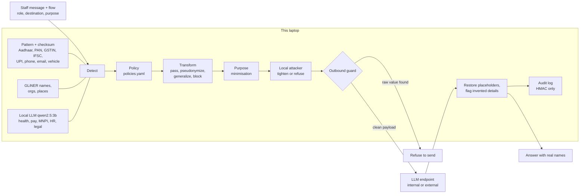

# Chaperone

[](https://github.com/MuazTPM-YT/devhack2026-round1/actions/workflows/ci.yml)

A local privacy gateway that sits between office staff and an AI chatbot. It decides what may leave based on the
**flow** (what the data is, whose it is, who sends it, where it goes, and why), not on keywords.

> "Priya is on leave next week" is fine for a scheduling assistant.
> "Priya is on leave next week for chemotherapy" is not; the medical detail is made vague before it leaves.

Masking names and IDs is the floor; many tools do it (see [Prior art](#prior-art-and-whats-different)). Chaperone
adds a step after masking: a **local attacker model reads every outgoing message**, and the conversation so far,
and asks what it could work out. "Meena is on tamoxifen" has no diagnosis in it, but a reader can infer breast
cancer. If the flow forbids that inference, Chaperone makes the evidence vaguer and asks again. If two rounds do not
clear it, the message is not sent.

Built for DevHack 2026, problem statement 2.2 (context-aware data privacy). Target users: small Indian clinics, CA
firms, college offices and SMEs that paste client data into external AI tools, face DPDP Act obligations, and
cannot afford enterprise DLP.


More: [only female cardiologist](docs/screenshots/s8b.png), [same message in three flows](docs/screenshots/s10.png).

## Contents

[Install](#install) · [Use the app](#use-the-app) · [How it works](#how-it-works) · [Configuration](#configuration) ·
[Change the rules](#change-the-rules) · [HTTP API](#http-api) · [Agents (MCP)](#agents-mcp) · [Results](#results) · [Limitations](#limitations) ·
[Development](#development) · [Troubleshooting](#troubleshooting) · [Security](#security)

## Install

### Requirements

| Need | Notes |
|---|---|
| Linux or macOS | Windows is not supported: the audit log uses `fcntl`. WSL2 may work but is not tested. |
| [uv](https://docs.astral.sh/uv/) | Installs Python 3.12 and every package from the lockfile. |
| [Ollama](https://ollama.com) | Runs the local model `qwen2.5:3b` (about 2 GB). |
| About 6 GB of disk | Python packages, the local model, the name model. |
| A GPU is optional | A 4 GB GPU is enough. On CPU the checks are slower. |

### Steps

The commands work in bash, zsh and fish.

1. **Install uv** (skip if `uv --version` works):

   ```sh
   curl -LsSf https://astral.sh/uv/install.sh | sh
   ```

2. **Install Ollama** (skip if `ollama --version` works):

   ```sh
   curl -fsSL https://ollama.com/install.sh | sh     # Linux
   sudo pacman -S ollama                             # Arch Linux (ollama-cuda for NVIDIA GPUs)
   ```

   On macOS, download the app from [ollama.com/download](https://ollama.com/download).

3. **Start Ollama** and check that it answers:

   ```sh
   sudo systemctl enable --now ollama   # Linux with the systemd service (the installer adds it)
   ollama serve                         # or: in its own terminal, if there is no service
   ollama list                          # must print a table, not "could not connect"
   ```

   On macOS, open the Ollama app.

4. **Get the code and run setup** (once):

   ```sh
   git clone https://github.com/MuazTPM-YT/devhack2026-round1.git
   cd devhack2026-round1
   ./setup.sh
   ```

   `setup.sh` installs the Python packages, pulls `qwen2.5:3b`, downloads the name model, and writes `.env` with a
   fresh random audit key. It stops with a clear message if uv or Ollama is missing or not running.

5. **Start Chaperone**:

   ```sh
   uv run --frozen python -m chaperone
   ```

   Wait for `context layer ok`, then open <http://127.0.0.1:8000>. If it prints `context layer OFFLINE`, see
   [Troubleshooting](#troubleshooting).

After setup nothing needs the internet. `--frozen` stops uv from checking the lockfile online.

## Use the app

The page is a chat with three lanes, so you see both ends of every message:

| Lane | What it shows |
|---|---|
| **You** (left) | Your message with every finding highlighted, and the reply with the real names and values put back. |
| **Chaperone** (middle) | Each check as it runs: find, apply the rules, try to infer, final check, put the values back. |
| **External AI** (right, hatched) | Exactly what the AI received and what it wrote, placeholders included. The dashed line is the edge of this laptop. |

1. **Pick a scenario** on the start screen or in the side rail, or type your own message.
2. **Set the flow** in the top bar: who sends it, to the internal model or the external AI, for which purpose, and
   under which rules (Standard or HIPAA Safe Harbor). The flow decides what may leave.
3. **Send** with Enter. Shift + Enter adds a new line.
4. Open **Details** under a step to see each decision, its rule and the reason, what the attacker inferred, and what
   masking names alone would have leaked.
5. A value left out for the purpose has **Include anyway**. It asks for a reason, which the audit log keeps with names
   removed.
6. **Copy** above your reply copies it with the real values.
7. **Compare three flows** (under the message box) runs the same message through three flows as a dry run. Nothing
   is sent.
8. The side rail also has **View the rules** (see [Change the rules](#change-the-rules)), **Person report**,
   **Check the audit log seal**, and **Download processing record (CSV)**. See [Accountability](#accountability).

Open `http://127.0.0.1:8000/#7` to run scenario 7 at once (any scenario id works). The theme button cycles automatic,
light and dark. Below 1360 px wide the side rail opens from the menu button; on phones the lanes stack in order.

## How it works



1. **Detect, locally.** Three layers. Patterns with checksums (python-stdnum) find Indian IDs and read who holds
   them: a PAN's 4th letter says person or company, and a GSTIN embeds a PAN, so a sole proprietor's GSTIN is
   personal. GLiNER finds names, organisations and places. A small local LLM labels meaning a pattern cannot see:
   health, pay, unpublished company results (MNPI), HR and legal matters, in English and Hinglish. Before the
   LLM reads the text, IDs and names are swapped for tags like `[AADHAAR]`, so it judges meaning, not numbers.
   Pay, HR and MNPI findings get a second, narrower question about that one phrase, because extraction alone
   called invoice totals "salary", a moved meeting an "HR matter" and a rent increase "unpublished results".
   Long text is read in sentence-sized windows (about 250 characters): on a 1,274-character paste the 3B model
   found nothing at all when given the whole thing. A full name found once also masks its first name used
   alone later ("Rohan wants…"), with the same placeholder.
2. **Decide per flow.** `chaperone/policies.yaml` holds 18 ordered rules (see [Change the rules](#change-the-rules)) over category, data subject (person or
   business), sender role, destination and purpose. The first match wins, and every decision records its rule id
   and a plain reason.
3. **Transform.** `pass` sends as is. `pseudonymize` swaps in `[PERSON_1]`, the same in every turn of the
   conversation. `generalize` sends a vague version inside a placeholder, `[AGE_1: in their 50s]` or
   `[DATE_1: March 2026]`, so the reply gets the exact value back on this laptop. Pay becomes a band ("senior
   salary band (₹10–30 lakh/yr)"). `block` withholds a span, or the whole request.
4. **Minimise for the purpose.** Each purpose in `policies.yaml` lists identifiers it does not need. A clinical
   summary does not need the family's phone number, so it is left out, not even sent as a placeholder. The user can
   click "Include anyway"; that needs a reason, and the audit log stores it as a hash plus a masked copy.
5. **Attack, then tighten.** A local model (qwen2.5:3b, two short few-shot calls: identity and health) reads the
   outbound text plus earlier messages to the same destination. An inference counts only if (a) its evidence words
   appear in the outbound text outside our own placeholders, (b) a second, narrower question confirms it, and (c)
   the flow's policy would not `pass` that category raw. Evidence is generalized first, then blocked. At most 2
   rounds; if the attacker is still not cleared, the request is refused with the reason. The UI shows "No
   inference found by the local check", never "safe".
6. **Guard.** The only code path to an LLM checks the full outbound payload, history included, for every raw value
   that was masked in this conversation (spacing and case ignored) and refuses to send if one is found.
7. **Restore and check.** Placeholders in the reply are swapped back on the laptop, tolerating `PERSON_1`,
   `Person 1`, `[person_1]`. Then a local check marks ages, dates, amounts, long numbers and names in the reply
   that the source never said: the external model sometimes invents them ("the 62-year-old patient").
8. **Audit.** `data/audit.jsonl` stores rule ids, actions, placeholders, the recipient (endpoint host and model)
   and HMAC-SHA256 tags of values. Never raw values. Every line is sealed; see [Accountability](#accountability).

If the local LLM is down, detection falls back to patterns and names, and the UI says so in red. Health, pay, HR,
legal and MNPI details are not caught in that mode.

## Change the rules

What may leave is decided by rule files, not by code:

| File | What it holds |
|---|---|
| `chaperone/policies.yaml` | The Standard rules, the sender roles, and the purposes with what each one leaves out |
| `chaperone/policies_safe_harbor.yaml` | HIPAA Safe Harbor mode. Its rules run first; anything they do not decide goes on to the Standard rules |
| `chaperone/policies_<name>.yaml` | Any new file named like this becomes a new rule set in the top bar. Give it a `name:` and usually `extends: policies.yaml`. It appears after a page reload |
| `data/policies.local.yaml` | Edits made in the app (admin mode). Not committed. Delete it to go back to the shipped rules |

A rule:

```yaml
  - id: salary-not-for-marketing           # lowercase letters, digits, dashes; unique
    when: {label: COMPENSATION, destination: external, purpose: marketing}
    action: block                          # pass | pseudonymize | generalize | block
    scope: request                         # optional, block only: stop the whole message
    why: Pay data has no place in an external marketing tool.   # users see this
```

- Rules are checked from the top. **The first rule that matches decides.** A condition left out matches anything.
- `when` keys are `label`, `subject` (`individual`, `business`, `unknown`), `role`, `destination` (`internal`,
  `external`) and `purpose`. Each takes one value or a list.
- A rule set that extends nothing must end with a catch-all: a rule with no `when`.
- `generalize` can take `coarse: year` (dates to the year) or `coarse: age90` (ages over 89 become "90 or older").

**Changes apply without a restart.** Save the file and the next message uses it. Every rule is checked first: an
unknown label, role or purpose, a missing reason, a duplicate id, or a catch-all that is not last is refused. If a
changed file is invalid, the previous rules stay in use and the Rules panel says what is wrong. A rule file that is
invalid when the app starts stops it with the reason.

**In the app.** Anyone can open **View the rules** in the side rail. A rule name under "Details" opens the rule that
decided. To edit in the app, start the server in admin mode:

```sh
CHAPERONE_ADMIN=1 uv run --frozen python -m chaperone
```

The panel then lets you add, edit, reorder and delete rules and choose what each purpose leaves out. **Try it** runs a
message under the saved rules and under your edit, side by side, without sending or saving anything. **Save rules**
checks the edit on the server and writes it to `data/policies.local.yaml`. **Reset to shipped rules** removes the
edits. Every save and reset is sealed into the audit log with a fingerprint of the rules before and after.

Admin mode is off by default on purpose: Chaperone checks staff messages, so staff should not be able to loosen the
checks from the same page. Whoever starts the server decides.

**What stays in code, and why.** The ID patterns and checksums, the final check that refuses to send a masked value,
the attacker loop, and the audit seal are safety parts, not preferences; switching them off at runtime would turn
protection off silently. The two destinations are fixed because each is an endpoint in `.env`. Only identifiers (phone,
email, UPI, Aadhaar, PAN, GSTIN, IFSC, vehicle) can be left out for a purpose; leaving out a name or a clinical fact
would make the answer wrong.

## Configuration

Settings live in `.env` (see `.env.example`). `setup.sh` writes it; it is not committed. Values already set in the
environment win over `.env`. A missing required value stops the app at start with the variable's name.

| Variable | Required | Default in `.env.example` | What it does |
|---|---|---|---|
| `INTERNAL_LLM_BASE_URL` | yes | `http://127.0.0.1:11434/v1` | OpenAI-compatible endpoint of the organisation's own model |
| `INTERNAL_LLM_MODEL` | yes | `qwen2.5:3b` | Model name at that endpoint |
| `INTERNAL_LLM_API_KEY` | no | empty | Bearer key, if the endpoint needs one |
| `EXTERNAL_LLM_BASE_URL` | yes | `http://127.0.0.1:11434/v1` | The "external AI". The default is local Ollama standing in for a third party |
| `EXTERNAL_LLM_MODEL` | yes | `qwen2.5:3b` | Model name at that endpoint |
| `EXTERNAL_LLM_API_KEY` | no | empty | Bearer key for a real hosted API |
| `AUDIT_HMAC_KEY` | yes | `change-me` (refused) | Secret for the audit log's tags and seals. `setup.sh` generates one |
| `OLLAMA_URL` | no | `http://127.0.0.1:11434` | Where the local checks reach Ollama |
| `CONTEXT_MODEL` | no | `qwen2.5:3b` | Local model for meaning and for the attacker |
| `CONTEXT_TIMEOUT` | no | `20` | Seconds before a local model call gives up |
| `CONTEXT_CHUNK` | no | `250` | Characters per window when long text is read |
| `NER_MODEL` | no | `urchade/gliner_small-v2.1` | Name, organisation and place model |
| `ATTACK_CATEGORIES` | no | `IDENTITY,HEALTH` | What the attacker looks for; add `COMPENSATION,HR,LEGAL` to widen it |
| `ATTACK_MAX_ROUNDS` | no | `2` | Tightening rounds before a message is refused |
| `ATTACK_MIN_CONFIDENCE` | no | `0.7` | Lowest attacker confidence that counts |
| `PORT` | no | `8000` | Port of the web app (always bound to `127.0.0.1`) |
| `CHAPERONE_ADMIN` | no | empty | `1` lets the page edit the rules ([Change the rules](#change-the-rules)). Leave it empty for staff |
| `CHAPERONE_DEV` | no | empty | `1` shows a "Demo data / Worst case" switch with stress-test messages |

To use a real hosted AI as the external destination, set three lines and restart. No code changes:

```sh
EXTERNAL_LLM_BASE_URL=https://api.openai.com/v1
EXTERNAL_LLM_MODEL=gpt-4o-mini
EXTERNAL_LLM_API_KEY=sk-...
```

## HTTP API

All endpoints are on `http://127.0.0.1:8000`. Bodies are JSON.

| Method and path | What it does |
|---|---|
| `GET /api/meta` | Roles, purposes, rule packs, scenarios, configured models |
| `POST /api/chat` | Check, send, restore. Answers once with the full result |
| `POST /api/chat/stream` | Same as `/api/chat`, as [JSON lines](#live-steps), one per step |
| `POST /api/compare` | Dry run of one message in up to 4 flows. Nothing is sent |
| `POST /api/baseline` | What masking names and IDs alone would send, and what the attacker infers from it |
| `POST /api/reset/{session_id}` | Forget one conversation's placeholder map |
| `POST /api/person-report` | `{"value": "Ramesh Rao"}`: every logged request that carried this name or ID |
| `GET /api/audit/verify` | Check the audit log's seal chain |
| `GET /api/records.csv` | One row per request: purpose, destination, categories, actions. No personal values |
| `GET /api/policies` | The rule sets, purposes and the allowed values for each condition |
| `PUT /api/policies/{pack}` | Admin mode: `{"rules": [...], "purposes": {...}}`. Checked, saved to `data/policies.local.yaml`, sealed in the log. `422` with the reason if invalid |
| `DELETE /api/policies/{pack}` | Admin mode: drop the local edits of one rule set |
| `POST /api/policies/preview` | Admin mode: one message under the saved rules and under candidate rules. Nothing is sent or saved |

Without admin mode the three admin endpoints answer `403`. Requests whose `Host` is not `127.0.0.1` or `localhost`
are refused with `400`.

A chat request:

```sh
curl -s http://127.0.0.1:8000/api/chat -H 'Content-Type: application/json' -d '{
  "session_id": "demo-1",
  "text": "Draft an invoice to Suresh Kumar, PAN ABKPS7312M, for ₹45,000 of printing work.",
  "role": "Accountant", "destination": "external", "purpose": "invoicing",
  "pack": "default", "use_context": true
}'
```

| Field | Values |
|---|---|
| `text` | 1 to 4,000 characters |
| `role` | `Manager`, `HR`, `Sales`, `Intern`, `Doctor`, `Accountant` |
| `destination` | `internal`, `external` |
| `purpose` | `general`, `scheduling`, `hr_summary`, `marketing`, `clinical_summary`, `invoicing` |
| `pack` | `default`, `safe_harbor` |
| `use_context` | `false` turns off the local model checks (IDs and names only) |
| `include` | Optional: `[{"label": "PHONE", "text": "98450 12345", "reason": "..."}]` for "Include anyway" |

### Live steps

`/api/chat/stream` sends one JSON object per line as each step finishes, then the full result:

```json
{"step": "detect", "items": [{"label": "PERSON", "text": "Suresh Kumar", "source": "ner"}], "context_ok": true, "ms": 412.3}
{"step": "decide", "counts": {"pseudonymize": 2}, "blocked": false, "ms": 3.1}
{"step": "attack", "round": 0, "ms": 1180.4, "found": [], "skipped": ""}
{"step": "ready", "outbound": "Draft an invoice to [PERSON_1], PAN [PAN_1], for ₹45,000 of printing work.", "blocked": false, "ms": 1610.2}
{"step": "guard", "checked": 4}
{"step": "reply", "reply": "...", "ms": 980.0}
{"step": "restore", "restored": "...", "stats": {"exact": 2, "fuzzy": 0}, "flags": 0}
{"step": "result", "result": {"...": "same object as /api/chat"}}
```

`attack` comes once per round, or once with `round: null` and a `skipped` reason. A blocked request, or one the final
check refuses, goes from `ready` straight to `result`, and the result says why. A server fault sends
`{"step": "error", "error": "<type>"}` instead of `result`; details go to the terminal.

## Agents (MCP)

`uv run --frozen python -m chaperone.mcp_server` starts a stdio MCP server with two tools. `chaperone_check` is a
dry run: it returns what would leave and what the attacker could still infer. `chaperone_send` sends through the
same pipeline and returns the restored reply plus any invented-detail flags. Results never echo masked raw values
back to the agent. Example client entry:

```json
{"mcpServers": {"chaperone": {"command": "uv", "args": ["run", "--frozen", "python", "-m", "chaperone.mcp_server"],
                              "cwd": "/path/to/DevHack2026"}}}
```

## Results

### What a reader can still work out (inference leaks)

`eval/run_inference.py` on `eval/inference_dev.jsonl`: 32 messages (15 health proxies such as a hospital, a drug or
an aid; 9 descriptions that point to one person; 2 with both; 6 controls with nothing to infer; 5 in Hinglish).
A different, larger model (llama3.1:8b, its own prompt) grades each outbound text: can a reader conclude the
forbidden fact? It could on the raw text for 23 of 28 facts; those 23 are the denominator. Asked the same claims
about unrelated messages, it said yes 1 time in 28.

| System | Inference leak rate ↓ | Health proxies | Who-is-it hints | Usefulness ↑ | Refused | Latency p50 / p95 |
|---|---|---|---|---|---|---|
| Names and IDs masked only (our ablation) | 100% (23/23) | 100% (16/16) | 100% (9/9) | 94% | 0/32 | 1979 / 3452 ms* |
| Chaperone, attacker and purpose off | 70% (16/23) | 62% (10/16) | 67% (6/9) | 86% | 0/32 | 410 / 778 ms |
| **Chaperone full** | **35% (8/23)** | **19% (3/16)** | 56% (5/9) | 81% | 2/32 | 3437 / 6746 ms |

\* This row also runs one attacker pass for the UI panel. GPU at 85–89 °C during the run.

- **Usefulness**: share of the task's key words (names, days) in the restored reply. A keyword check only.
- No false alarms on the 6 controls in any system. Two Hinglish health messages were refused after 2 rounds:
  nothing leaked, nothing was sent.
- **Read this honestly.** This is the dev set: we fixed a bug found by this run (a second check threw away proxy
  hints; health recall rose from 5/17 to 13/17) and reworded the grader's identity question. Before the fix,
  Chaperone full leaked 64%. Usefulness drops from 94% to 81%: vaguer text means the reply names fewer of the
  task's details. Who-is-it hints are the weak spot: the 3B attacker often judges "our CA who handles
  the three Goa clients" as more than five people. One graded leak (inf-024) is a grader error; no job title was
  left in the text. Full table and raw outputs: [`eval/results/inference_dev.md`](eval/results/inference_dev.md).
- CloakLLM and CloakPipe were not run. The first row is our own "names and IDs only" setting, not their code.

### Spans: what was written (detection and policy)

Numbers from `eval/run_eval.py` on the **dev** set: 86 hand-labelled cases (English and Hinglish, with contrast
pairs: the same text in two flows), 169 gold spans. **We tuned on this set, so these numbers are optimistic.** The
held-out set (`eval/heldout.jsonl`) is written by teammates who have not read the detector code; its results
will replace these.

| System | Leak rate ↓ | Over-redaction ↓ | Request blocks (TP/FP/FN) | Latency p50 / p95 |
|---|---|---|---|---|
| Chaperone (full, with attacker and purpose steps) | 2.0% (2/102) | 3.0% (2/67) | 5/0/0 | 1985 / 13131 ms* |
| Chaperone, context layer off | 38.2% (39/102) | 0.0% (0/67) | 0/0/5 | 40 / 52 ms |
| Presidio + India recognizers | 37.3% (38/102) | 70.1% (47/67) | 0/0/5 | 6 / 9 ms |

\* GPU at 85–89 °C and throttling after hours of runs; the slow tail is long messages that need attacker rounds.
Results move by about one span between runs because the 3B model is not fully deterministic.

- **Leak rate**: sensitive spans whose raw text reached the outbound payload.
- **Over-redaction**: spans that should have passed (company PAN, a colleague's name for scheduling) but were
  altered. It measures broken answers.

| Detection F1 | Chaperone | Presidio + India recognizers |
|---|---|---|
| Identifiers and entities | 0.98 | 0.74 |
| Only the labels Presidio supports | 0.98 | 0.82 |
| Context categories (health, pay, MNPI, HR, legal) | 0.85 | not supported |

Full per-label table: [`eval/results/results_dev.md`](eval/results/results_dev.md).

### What Presidio already does, and what we add

Fair comparison: Presidio 2.2.364 ships India recognizers (`IN_AADHAAR`, `IN_PAN`, `IN_GSTIN`,
`IN_VEHICLE_REGISTRATION`, `IN_VOTER`, `IN_PASSPORT`) but disables them by default. We enable all of them, keep its
default spaCy `en_core_web_lg`, and use a 0.3 score cut-off.

- Presidio **already validates the Aadhaar Verhoeff check digit**, as we do. Its Aadhaar scores match ours (F1
  1.00). It checks GSTIN structure but not the checksum. It finds phones and emails as well as we do.
- Presidio has no IFSC or UPI recognizer, and no notion of PAN holder type.
- Our gain is not checksums. It is (1) context categories no pattern can see, and (2) flow-aware decisions: Presidio
  redacts a company PAN and a colleague's name in a scheduling request (70% over-redaction), while it lets the
  chemotherapy detail and the salary through (37% leak).

### Choosing the local model

Benchmarked on the dev set ([`eval/results/models_dev.md`](eval/results/models_dev.md)). We use **qwen2.5:3b**:
the best precision, so the fewest false request blocks, and the same model doubles as the simulated external AI, so
only one model sits in 4 GB of VRAM.

| Model | Context F1 | Leak rate | Context p50 / p95 |
|---|---|---|---|
| qwen2.5:3b | 0.88 | 2.0% | 397 / 929 ms |
| qwen3:1.7b | 0.75 | 8.0% | 344 / 892 ms |
| gemma3:1b | 0.48 | 13.0% | 264 / 481 ms |

The prompt was tuned while using qwen2.5:3b, which favours it in this comparison. This benchmark ran before the
second checks and windowed reading were added.

### Placeholders survive

In 37 real replies from the local model, 59 of 61 placeholder mentions came back in exact `[LABEL_N]` form; the
other 2 were mangled and restored by tolerant matching. In 1 of 37 replies the model invented a placeholder that
was never sent, which stays visible as text ([`eval/results/placeholders_dev.md`](eval/results/placeholders_dev.md)).
The 3B model copies whatever the system prompt names: an example `[PAN_1]` produced invented placeholders in 4 of
37 replies, and an example "[health detail]" produced "[health detail]" in a message with no health data. The
prompt now mentions placeholders or vague phrases only when the outbound message actually contains them.

## Prior art and what's different

What we read before building v2, from each project's own documentation (October 2026). We did not run CloakLLM or
CloakPipe; nothing below is a measured comparison with them.

| Project | What it does | Overlap with Chaperone |
|---|---|---|
| [Presidio](https://github.com/microsoft/presidio) | Detects and anonymises PII with patterns, checksums and NER | Our detection baseline; measured above |
| [LLM Guard](https://github.com/protectai/llm-guard) | Input and output scanners for LLM apps, including an anonymiser with a reversible vault | Mask and restore |
| CloakLLM ([PyPI](https://pypi.org/project/cloakllm/), 0.12.0) | Masks PII before an LLM call and restores it in the reply | Mask and restore |
| [CloakPipe](https://github.com/rohansx/cloakpipe) (FOSS Hack 2026) | Privacy proxy in front of LLM APIs, mask and restore | Mask and restore, proxy design |
| AgentCloak | Masking for agents; also generalizes meaning ("headache" to a vaguer condition) | Semantic generalization |
| Staab et al., *Beyond Memorization*, ICLR 2024 ([arXiv 2310.07298](https://arxiv.org/abs/2310.07298)) | Shows LLMs infer personal attributes (location, age, health) from text with no explicit PII | The threat our attacker step tests for |
| Staab et al., *Language Models are Advanced Anonymizers*, ICLR 2025 ([arXiv 2402.13846](https://arxiv.org/abs/2402.13846)) | Adversarial anonymisation: an LLM attacker and an LLM anonymiser take turns until the attacker fails | **The closest idea to our attack-and-tighten loop.** We did not invent it. |

What Chaperone adds on top of that work:

1. **The flow decides what counts as a leak.** The same inference (cancer from "tamoxifen") is forbidden for a
   manager writing to an external chatbot and allowed for a doctor's clinical summary. Forbidden means: our policy
   would not pass that category raw in this flow. Staab et al. remove every inferable attribute.
2. **Small, local, and bounded.** The attacker is a 3B model on a 4 GB laptop GPU, two calls per round, at most 2
   rounds, then refuse. Evidence must be words in the outbound text, outside our own placeholders; an inference
   that quotes words that are not there is dropped.
3. **Reversible.** Vague text leaves (`[AGE_1: in their 50s]`); the exact value comes back locally in the reply.
4. **Conversation memory.** The attacker reads earlier messages to the same destination, so details split across
   turns are caught; the exposure ledger lists what the external model could already infer about each person.
5. **Purpose minimisation and an audit trail** with hashed values and logged "Include anyway" reasons.
6. **Per-person accountability without a store of personal data.** A person report lists every request that carried
   one person's name or ID, and the log is sealed against edits. The tools in the table above protect a message;
   none that we read answers "where did this person's data go?".

## HIPAA Safe Harbor mode

`chaperone/policies_safe_harbor.yaml` is a policy pack that follows the 18 identifier types in the HIPAA Safe
Harbor list (45 CFR 164.514(b)(2)) where text can carry them: names, places smaller than a state (all places, since
we have no gazetteer), all date parts except the year, ages over 89, contact details, record, account and ID
numbers, vehicle IDs, URLs and IP addresses. Aadhaar, personal PAN, hospital UHIDs, UPI handles and a sole
proprietor's GSTIN are **our adaptation** for India, not part of the US rule. Health plan numbers, licence numbers,
device serials, biometrics and photos are not detected. This mode helps a person
remove identifiers; it does not make anyone meet HIPAA, and Safe Harbor also needs the sender to have no
actual knowledge that the rest identifies the person.

India's DPDP Act asks for a specified purpose and data minimisation. In Chaperone the purpose is part of every flow,
and the purpose step above drops identifiers the purpose does not need.

## Accountability

**Person report.** Open "Person report" in the side rail and type a full name or an ID (or `POST /api/person-report {"value": ...}`). Chaperone
computes the keyed tag of that value on this laptop and lists every logged request that carried it: when, which flow,
which endpoint and model received it, and what happened to the value (sent as typed, as a placeholder, made vague,
left out, withheld). The log holds only tags, so it is not itself a copy of the personal data, and the value asked
about is not stored. This is the record a data principal can ask for under the DPDP Act (right to information about
processing). Values are tagged in canonical form, so `7260 1815 9082` finds `726018159082`; a first name used alone
after a full name is tagged as the full name.

**Sealed log.** Each audit line carries an HMAC over its content and the previous line's seal. `GET /api/audit/verify`
(or "Check the audit log seal") walks the chain and names the first line that was edited, added, removed or moved.
Two processes (the web app and the MCP server) can write at once; a file lock keeps the chain in order.

Limits: lines cut off the end are caught only by comparing the head value with a copy kept elsewhere. Anyone with
`AUDIT_HMAC_KEY` can rewrite the whole log, so keep the key away from people who can edit the file. Lines written
before this version have no seal and are reported as "older lines"; their tags use the value as typed, so the person
report finds them only when the value is typed the same way. A name typed differently from the message ("Priya"
for "Priya Sharma") is not found.

## Design decisions

| Question | Choice | Cost |
|---|---|---|
| Where detection runs | On the laptop, always | A cloud detector would leak what it checks. |
| Simulated or real external AI | Simulated: local Ollama behind an OpenAI-compatible URL | The 3B stand-in writes weaker answers than a hosted model. To switch, set `EXTERNAL_LLM_BASE_URL`, `EXTERNAL_LLM_MODEL`, `EXTERNAL_LLM_API_KEY` in `.env`; no code change. |
| Placeholder content | Type only: `[PERSON_1]`; a generalized span adds its vague value: `[AGE_1: in their 50s]` | Type plus role (`[PATIENT_1]`) helps reasoning but tells the provider who is a patient. Gender guessed from names is unreliable and leaks more. |
| Unknown flows | Identifiers pseudonymize, sensitive details generalize | Block-by-default gives useless answers ("[PERSON withheld] has been diagnosed with [HEALTH withheld]"); pass-by-default leaks. Examples: [`eval/results/default_effect.md`](eval/results/default_effect.md). |
| Same value in later turns | Stays masked for that destination | Internal and external conversations keep separate maps. |
| Frontend | One HTML file, no build, no CDN; fonts (Inter, JetBrains Mono, OFL) ship in `chaperone/static/fonts` | Works offline in the demo. |
| Live steps | `POST /api/chat/stream` sends one JSON line per step (find, rules, each attack round, final check, reply, restore), then the full result | The page shows each check as it finishes. `/api/chat` still answers once, for scripts and tests. |
| Attacker vs. a second "anonymiser" model | One attacker; tightening reuses our own generalize and block | Staab et al. let an LLM rewrite freely. A free rewrite can drop task facts and cannot be restored. |
| Purpose needs | Declared per purpose in `policies.yaml` | Asked per message, qwen2.5:3b said "needed" for almost every identifier. |

More in [docs/PLAN.md](docs/PLAN.md) and [docs/PLAN-v2.md](docs/PLAN-v2.md).

## Limitations

- The context layer is a 3B model. It is not fully deterministic across runs, and it missed some Hinglish names
  and conditions ("Kavya ... surgery") and "pregnant" as a health detail.
- The simulated external AI is the same 3B model. Its answers are short and sometimes add facts that were not
  in the message ("patient is now stable"). A hosted model would answer better.
- Long pasted text is slower (about 6.5 s of checks for 1,274 characters) and recall drops: in the stress test the
  vendor's "legal notice" went through unmarked.
- Ages written as a bare number ("Kavya Shetty, 29") are not caught.
- Addresses are not a category. Kannada is out of scope.
- Sessions live in memory; a restart forgets placeholder maps. Messages are capped at 4,000 characters.
- The attacker is a 3B model. "No inference found by the local check" means this model found nothing; a larger
  model, or a person who knows the patient, may infer more. It checks identity and health by default; pay, HR and
  legal inferences are opt-in (`ATTACK_CATEGORIES`) because that call caused most false alarms.
- It errs cautious: a leave note for an intern made it infer "pregnancy" from the leave wording, and the message was
  made vaguer than needed. The attacker adds 0.25 to 4.5 s per message.
- Evidence already sent in an earlier message cannot be pulled back. The UI marks it "already disclosed earlier".
- Purpose needs are declared per purpose, not judged per message. A mislabelled purpose can omit something the task
  needs; "Include anyway" is the way out.
- The invented-detail check finds ages, dates, amounts, long numbers and names. It does not judge invented clinical
  facts ("patient is now stable").
- The attacker's own safer wording can carry health back in: "uses a white cane and a screen reader" became "a
  person with mobility and visual impairments" (inf-004).
- HIPAA Safe Harbor mode removes identifiers in text. It does not make anyone meet HIPAA.
- All results are on our own dev sets. The held-out sets are empty until teammates fill them; do not quote dev
  numbers as final.

## Development

```sh
uv run --frozen pytest                     # all 100 tests; 20 scenario tests need Ollama running
uv run --frozen pytest -m "not ollama"     # the 80 that run anywhere (what CI runs)
uv run --frozen ruff check chaperone tests eval
uv run --frozen mypy chaperone
```

CI ([`.github/workflows/ci.yml`](.github/workflows/ci.yml)) runs ruff, mypy and the tests without Ollama on every
push to `main` and every pull request.

Evaluation:

```sh
uv run --frozen python eval/run_eval.py --split dev          # or --split heldout
uv run --frozen python eval/run_inference.py --split dev     # inference leaks; needs llama3.1:8b as the grader
uv run --frozen python eval/add_case.py                      # add a held-out case
```

UI stress test: start with `CHAPERONE_DEV=1 uv run --frozen python -m chaperone` and use the "Demo data / Worst case"
switch at the bottom of the page. Without that variable the switch and the stress data are not served.

| Path | What |
|---|---|
| `chaperone/detect.py` | Three detection layers |
| `chaperone/policies.yaml`, `policy.py` | Rules, roles and purposes; matcher, checks, live reload, admin edits |
| `chaperone/policies_safe_harbor.yaml` | HIPAA Safe Harbor policy pack |
| `chaperone/transform.py` | Actions, placeholder vault, outbound guard, restore |
| `chaperone/attack.py` | Local attacker, evidence check, safer wording |
| `chaperone/purpose.py` | Purpose minimisation |
| `chaperone/verify.py` | Flags invented ages, dates, amounts and names in replies |
| `chaperone/gateway.py` | Pipeline, live step events, the single LLM call path, sealed audit log, person report, processing record |
| `chaperone/app.py` | HTTP API, including the live step stream |
| `chaperone/static/index.html` | The whole UI, including the Rules panel: one file, no build step |
| `chaperone/static/fonts/` | Inter and JetBrains Mono (SIL Open Font License), so the UI works offline |
| `chaperone/mcp_server.py` | MCP tools for agents |
| `chaperone/scenarios.json` | The demo scenarios, used by the UI and the tests |
| `chaperone/scenarios_worst.json` | Stress-test messages (long names, scripts, emoji, a long paste); dev only |
| `eval/` | Datasets, harness, baseline, model and placeholder tests ([guide](eval/README.md)) |
| `tests/` | Unit and end-to-end tests |
| `docs/DEMO.md` | Demo video runbook |
| `docs/PLAN.md`, `docs/PLAN-v2.md` | Build plans |

## Troubleshooting

| What you see | Cause and fix |
|---|---|
| Start prints `context layer OFFLINE`; the page says "Local AI check: offline" | Ollama is not running, or the model is missing. Run `ollama list`; start Ollama ([step 3](#steps)); run `ollama pull qwen2.5:3b`. Without it only IDs and names are checked. |
| `ollama`: `could not connect to ollama server` | The server is not running. Start it ([step 3](#steps)). |
| `ollama list` is empty although the model was pulled | `ollama serve` run as your user looks in `~/.ollama`, but the system service keeps models in `/var/lib/ollama`. Stop it and use `sudo systemctl start ollama`. |
| `missing required env var ...` | There is no `.env`. Run `./setup.sh`, or copy `.env.example` to `.env` and fill it in. |
| `AUDIT_HMAC_KEY still has the example value` | Run `./setup.sh`, or set a random key: `uv run --frozen python -c "import secrets; print(secrets.token_hex(32))"`. |
| `address already in use` | Port 8000 is taken. Start on another one: `PORT=8001 uv run --frozen python -m chaperone`. |
| The first message is slow | The models load on first use. Later messages are faster. A cold start can take 2 to 3 s. |
| A scenario gives a different result now and then | The 3B local model is not fully deterministic. Send it again. |
| 20 tests fail with `context_ok` errors | Those tests need Ollama. Start it, or run `pytest -m "not ollama"`. |
| The Rules panel says a rule file has an error | A file was changed by hand and is invalid; the previous rules are still in use. Fix the file named in the message, or delete `data/policies.local.yaml`. |
| The app stops at start with a rule error | A rule file is invalid and there is no earlier version to fall back on. Fix the file named in the message. |
| "Rule editing is off" | Start the server with `CHAPERONE_ADMIN=1`. |

## Security

- The app listens on `127.0.0.1` only and has no login. Do not expose it to a network.
- Detection, policy, the attacker and restore all run on this machine. Only the final, checked text goes to the
  configured LLM endpoint, and a final guard refuses to send it if any masked raw value is still in it.
- `data/audit.jsonl` holds HMAC tags of values, never the values. Keep `AUDIT_HMAC_KEY` secret: anyone with it can
  rewrite the log (see [Accountability](#accountability)).
- `.env` holds the keys and is in `.gitignore`. Never commit it.
- Conversations are kept in memory only and are gone when the app stops.
- Rule editing is off unless the server is started with `CHAPERONE_ADMIN=1`. Every rule change is sealed in the
  audit log. Requests for any other host name are refused, so a web page cannot reach the app through DNS rebinding.

## License

MIT. Uses open-source libraries: FastAPI, GLiNER (`urchade/gliner_small-v2.1`, Apache-2.0), python-stdnum,
Ollama with Qwen2.5-3B, Llama 3.1 8B as the evaluation grader only, and Presidio for the baseline. The Inter and
JetBrains Mono fonts are under the SIL Open Font License; the licence texts are in `chaperone/static/fonts/`.
